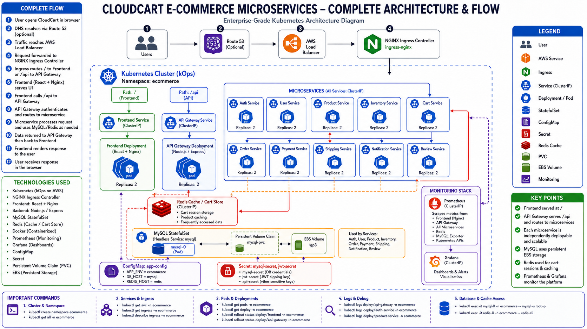
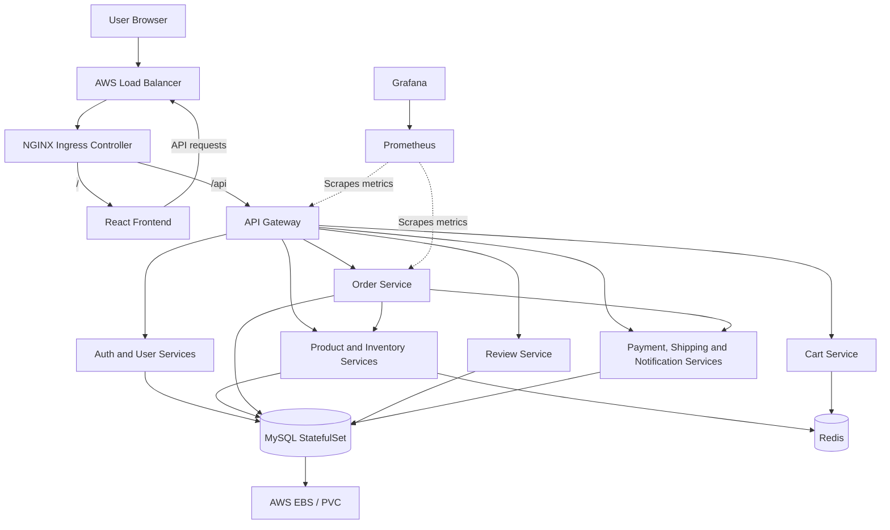
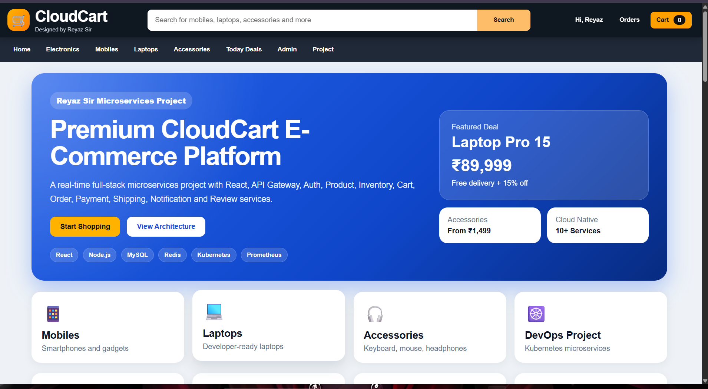

<div align="center">

# 🛒 CloudCart – Microservices Platform

### Cloud-Native E-Commerce | AWS | Kubernetes | DevOps | Observability


**A production-style, distributed e-commerce application deployed on AWS using a kOps-managed Kubernetes cluster.**

[Architecture](#-system-architecture) • [Microservices](#-microservices) • [Deployment](#-deployment-guide) • [Monitoring](#-monitoring--observability) • [Author](#-author)

</div>

## 📖 Project Overview

CloudCart is a full-stack cloud-native e-commerce platform built to demonstrate distributed application architecture, containerization, Kubernetes orchestration, persistent storage and application observability.

The platform combines a React storefront, a centralized API Gateway and 10 independently deployed Node.js microservices. MySQL provides persistent relational storage, while Redis supports cart storage and product caching. AWS Load Balancer and NGINX Ingress expose the application, and Prometheus and Grafana provide monitoring and visualization.

## ✨ Key Features

- 🛍️ Product catalog, category filtering and product search
- 🔐 User registration, authentication and profile management
- 🛒 Shopping cart backed by Redis
- 📦 Inventory validation and stock management
- 💳 Mock payment processing with success and failure scenarios
- 🚚 Order orchestration, shipping and tracking
- 🔔 Order notifications and product reviews
- 🛠️ Admin product creation
- ☸️ Independent Kubernetes deployments and health probes
- 💾 Persistent MySQL storage using PVC and AWS EBS
- 📊 Application metrics and Grafana dashboards
- 📈 Optional Horizontal Pod Autoscaling (HPA)

## 🏗️ System Architecture



### Request Flow



## 🧩 Microservices

| Service | API route | Responsibility |
|---|---|---|
| Auth | `/api/auth` | Registration and login |
| User | `/api/users` | User profile management |
| Product | `/api/products` | Product catalog and administration |
| Inventory | `/api/inventory` | Stock validation and management |
| Cart | `/api/cart` | Redis-backed shopping cart |
| Order | `/api/orders` | Order orchestration |
| Payment | `/api/payments` | Simulated payment processing |
| Shipping | `/api/shipping` | Shipment and tracking creation |
| Notification | `/api/notifications` | Order notifications |
| Review | `/api/reviews` | Product reviews |

**Supporting components:** API Gateway for centralized routing and React + NGINX for the frontend.

### 🔄 Order Processing Workflow

The Order Service coordinates inventory validation, mock payment processing, shipment creation and notifications. Order and payment records are stored in their respective MySQL schemas.

## 🛠️ Technology Stack

| Layer | Technologies |
|---|---|
| Frontend | React, NGINX |
| Backend | Node.js, Express.js, REST APIs |
| Database | MySQL, separate logical service schemas |
| Cache | Redis |
| Containerization | Docker, Docker Hub |
| Orchestration | Kubernetes, kOps |
| Cloud | AWS EC2, Load Balancer, EBS |
| Networking | Kubernetes Services, NGINX Ingress |
| Monitoring | Prometheus, Grafana, ServiceMonitor |
| Automation | Bash scripts, Helm, kubectl |
| Version control | Git, GitHub |

## 📁 Project Structure

Representative layout of the generated application:

```text
CloudCart-Microservices-Platform/
├── architucture/
│   ├── architecture-new.png
│   └── Dashboard.png
├── database/
│   └── init.sql
├── frontend/
│   ├── src/
│   ├── Dockerfile
│   ├── nginx.conf
│   └── package.json
├── services/
│   ├── api-gateway/
│   ├── auth-service/
│   ├── user-service/
│   ├── product-service/
│   ├── inventory-service/
│   ├── cart-service/
│   ├── order-service/
│   ├── payment-service/
│   ├── shipping-service/
│   ├── notification-service/
│   └── review-service/
├── k8s/
├── scripts/
│   ├── build-push.sh
│   ├── deploy.sh
│   └── verify.sh
└── README.md
```

## 🚀 Deployment Guide

### 1. Prerequisites

- AWS account and a working kOps Kubernetes cluster
- Configured AWS credentials, kubectl and kOps
- Docker, Docker Hub account, Git and Helm
- Working AWS EBS-backed Kubernetes storage class
- Sufficient CPU and memory on cluster nodes

### 2. Clone the repository

```bash
git clone https://github.com/abhisheksaste31-source/CloudCart-Microservices-Platform.git
cd CloudCart-Microservices-Platform
kubectl get nodes
```

Run the following commands from the generated application root (the directory containing `services/`, `frontend/`, `k8s/` and `scripts/`). If starting from the supplied generator instead, inspect it before running: it replaces its target project directory. Set a unique database password and JWT secret before generating manifests.

### 3. Build and push Docker images

```bash
export DOCKER_USER="your-dockerhub-username"
export IMAGE_TAG="v1"
docker login
bash scripts/build-push.sh
```

Ensure the image names and tags in `k8s/backend.yaml` and `k8s/frontend.yaml` match your pushed images. Configure Kubernetes Secrets securely before deployment.

### 4. Install NGINX Ingress Controller

```bash
helm repo add ingress-nginx https://kubernetes.github.io/ingress-nginx
helm repo update
helm upgrade --install ingress-nginx ingress-nginx/ingress-nginx \
  --namespace ingress-nginx --create-namespace \
  --set controller.service.type=LoadBalancer
```

### 5. Deploy CloudCart

```bash
bash scripts/deploy.sh
kubectl get pods,svc,ingress,pvc -n ecommerce
```

### 6. Access and verify the application

```bash
kubectl get svc -n ingress-nginx ingress-nginx-controller
kubectl get ingress -n ecommerce
```

Open the external load balancer DNS in your browser. Test the product API:

```bash
export APP_URL="http://YOUR-LOAD-BALANCER-DNS"
curl "$APP_URL/api/products"
```

## ☸️ Kubernetes Implementation

| Resource | Purpose |
|---|---|
| Deployment | Manage frontend and backend replicas |
| Service | Internal networking and service discovery |
| StatefulSet | Stable MySQL workload identity |
| PVC / EBS | Persistent database storage |
| ConfigMap | Application and database configuration |
| Secret | Database credentials and sensitive configuration |
| Ingress | Route frontend and API traffic |
| Readiness / liveness probes | Health checks and traffic readiness |
| Resource requests / limits | CPU and memory management |
| HPA (optional) | Replica scaling based on configured metrics |

## 📊 Monitoring & Observability



Prometheus collects application metrics from backend `/metrics` endpoints. Grafana visualizes service availability, request rates, order creation and payment outcomes.

### Install the monitoring stack

```bash
helm repo add prometheus-community https://prometheus-community.github.io/helm-charts
helm repo update
helm upgrade --install kube-prometheus-stack \
  prometheus-community/kube-prometheus-stack \
  --namespace monitoring --create-namespace
```

Apply the ServiceMonitor manifest provided by your project version (`k8s/monitoring-optional.yaml` in the supplied generator, or `k8s/monitoring.yaml` in the extended setup). Ensure its labels match the Prometheus ServiceMonitor selector.

```bash
kubectl apply -f k8s/monitoring-optional.yaml
kubectl port-forward -n monitoring svc/kube-prometheus-stack-grafana 3000:80
```

Open `http://localhost:3000` and authenticate using your configured Grafana credentials.

### Example PromQL queries

Run each query separately in Prometheus or Grafana:

| Metric | PromQL |
|---|---|
| Target availability | `up{namespace="ecommerce"}` |
| API Gateway request rate | `sum(rate(api_gateway_http_requests_total[2m]))` |
| Product request rate | `sum(rate(product_service_http_requests_total[2m]))` |
| Orders created | `order_service_orders_created_total` |
| Successful payments | `payment_service_success_total` |
| Failed payments | `payment_service_failed_total` |

## 🔒 Security & Operational Considerations

This is a production-style learning project, not a certified production-ready payment platform. Payments are simulated. Replace demonstration credentials, restrict IAM and network permissions, enable HTTPS, configure backups and avoid exposing Grafana or databases publicly before using the platform in a real environment.

AWS resources may incur charges. When finished, remove unused load balancers, storage and cluster infrastructure after backing up required data.

## 🎯 Learning Outcomes

- Designing distributed microservices and API Gateway routing
- Building and publishing container images
- Deploying full-stack applications on AWS Kubernetes using kOps
- Managing stateful workloads and persistent storage
- Implementing caching and inter-service communication
- Configuring ingress, health probes and resource management
- Monitoring application behavior with Prometheus and Grafana

## 👨‍💻 Author

**Abhishek Saste** — Cloud & DevOps Enthusiast

[](https://github.com/abhisheksaste31-source)
[](https://www.linkedin.com/in/abhisheksaste)

## 🙏 Acknowledgements

Special thanks to **Reyaz Sir** for the project design and practical guidance in DevOps and cloud-native technologies.

---

<div align="center">

⭐ If you find this project useful, consider starring the repository!

**Built with ☁️ Cloud, ☸️ Kubernetes and ❤️ DevOps**

</div>
